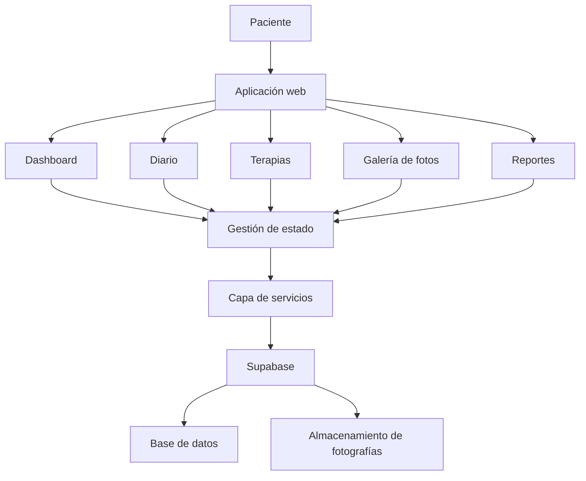

# Section Spark Layout

Genera y maqueta las secciones

This project was built with [Lovable](https://lovable.dev).

**Live app**: https://section-spark-layout.lovable.app

## Build with Lovable

Continue developing this project in the [Lovable editor](https://lovable.dev/projects/da741285-7bfb-4bad-a116-984f1e2a9079).

- **Ship faster**: describe what you want to build and Lovable handles the code.
- **Stay in sync**: every change made in Lovable is committed straight to this repository.
- **Full ownership**: this code is yours. Push to `main` on GitHub and your changes sync back into Lovable, ready for your next prompt.

## Development

Prefer working locally? You need Node.js and npm — [install with nvm](https://github.com/nvm-sh/nvm#installing-and-updating).

```sh
git clone <this-repository-url>
cd <repository-name>
npm i
npm run dev
```

# 🩵 Recupera — Seguimiento y rehabilitación de parálisis facial

<p align="center">
  <strong>Una herramienta digital para acompañar, registrar y visualizar el proceso de recuperación de pacientes con parálisis facial.</strong>
</p>

<p align="center">
  <a href="https://section-spark-layout.lovable.app/">
    
  </a>
  
  
</p>

---

## 📖 Descripción del proyecto

**Recupera** es una aplicación web responsive enfocada en el seguimiento, registro y rehabilitación de pacientes con parálisis facial.

Su propósito es proporcionar una herramienta digital que permita a los pacientes documentar diariamente su proceso de recuperación, organizar sus actividades terapéuticas, registrar síntomas, llevar un control de medicamentos y visualizar su evolución a través del tiempo.

La plataforma busca centralizar la información relevante del paciente en una interfaz intuitiva, accesible y fácil de utilizar, facilitando también el seguimiento por parte de profesionales de la salud, como neurólogos y fisioterapeutas.

Recupera está diseñada bajo un enfoque *mobile-first*, priorizando la accesibilidad, la facilidad de uso y una experiencia visual moderna.

### 🎯 Objetivo general

Desarrollar una aplicación web que facilite el seguimiento del proceso de recuperación de pacientes con parálisis facial mediante herramientas de registro, organización y visualización de información.

### 🎯 Objetivos específicos

- Registrar diariamente síntomas y estado de ánimo.
- Llevar un seguimiento de medicamentos y horarios.
- Organizar terapias y ejercicios de rehabilitación.
- Documentar visualmente la evolución mediante fotografías.
- Generar reportes de seguimiento.
- Facilitar la consulta de información relevante para profesionales de la salud.
- Promover una experiencia digital accesible, organizada y sencilla.

---

## ✨ Funcionalidades principales

### 🏠 1. Inicio / Dashboard

Panel principal que permite visualizar de manera rápida el estado general del seguimiento.

Características:

- Saludo personalizado.
- Indicador de días de recuperación.
- Tarjeta de progreso de recuperación.
- Acceso rápido para agregar un registro diario.
- Checklist de medicamentos.
- Consulta de próximas terapias.
- Resumen del estado de ánimo y síntomas.
- Indicador de actividades completadas.
- Calendario de actividad semanal.

### 📔 2. Diario de recuperación

Módulo destinado al registro y seguimiento de información diaria del paciente.

**Medicamentos:**

- Registro de medicamentos.
- Nombre y dosis.
- Frecuencia y horarios.
- Fecha de inicio y finalización.
- Estado de seguimiento.
- Registro de medicamentos tomados.

**Síntomas:**

- Escala visual de dolor del 1 al 10.
- Registro del estado de ánimo mediante emojis.
- Checklist de síntomas relacionados con la parálisis facial.
- Registro de molestias y observaciones.
- Historial de registros.
- Visualización de evolución mediante gráficos.

Síntomas contemplados:

- Dificultad para cerrar el ojo.
- Ojo seco.
- Alteración del gusto.
- Dolor detrás de la oreja.
- Hiperacusia.
- Asimetría al sonreír.
- Dificultad para levantar la ceja.
- Dificultad para beber o comer.

### 🧘 3. Terapias y ejercicios

Espacio para consultar y organizar las actividades de rehabilitación asignadas.

Características:

- Catálogo de terapias.
- Descripción e instrucciones de ejercicios.
- Duración y número de repeticiones.
- Frecuencia de realización.
- Temporizador de sesiones.
- Controles para iniciar, pausar y reiniciar.
- Checklist de ejercicios completados.
- Registro de molestias, dolor o fatiga.
- Historial de sesiones realizadas.
- Indicadores de progreso.

Categorías contempladas:

- Ejercicios frente al espejo.
- Masajes faciales.
- Electroestimulación.
- Termoterapia.
- Ejercicios funcionales.

### 📸 4. Fotos / Galería de evolución

Módulo destinado a documentar visualmente los cambios durante el proceso de recuperación.

Características:

- Captura o carga de fotografías.
- Guía visual de encuadre facial.
- Organización cronológica.
- Galería de fotografías.
- Etiquetas por fecha y día de recuperación.
- Clasificación por tipo de expresión.
- Comparación de fotografías de diferentes fechas.
- Comparador interactivo de antes y después.

Tipos de fotografías:

- Rostro en reposo.
- Sonrisa.
- Cierre de ojos.
- Gesto de soplar.

**Privacidad:** las fotografías faciales son información sensible y deben estar protegidas, con acceso limitado al paciente y a los profesionales autorizados.

### 📊 5. Reportes

Módulo para consultar y visualizar la información registrada durante el proceso de recuperación.

Características:

- Estadísticas generales.
- Gráfico de adherencia a medicamentos.
- Evolución del dolor y los síntomas.
- Seguimiento de sesiones terapéuticas.
- Calendario de registros.
- Resúmenes semanales y mensuales.
- Generación de reportes en PDF.

Los reportes están orientados a facilitar la consulta y el intercambio de información con el neurólogo o fisioterapeuta.

---

## 🎨 Diseño e identidad visual

La interfaz de Recupera utiliza una línea visual minimalista, moderna, cálida y clínica.

### Paleta de colores

| Color | Código | Uso |
|---|---|---|
| Azul lavanda | `#8B9FE8` | Color principal |
| Azul oscuro | `#263653` | Textos y navegación |
| Fondo claro | `#F6F8FC` | Fondo general |
| Blanco | `#FFFFFF` | Tarjetas y superficies |
| Verde menta | `#B8E4D2` | Elementos de acento |

### Principios de diseño

- Diseño adaptable a dispositivos móviles, tabletas y escritorio.
- Enfoque mobile-first.
- Navegación inferior en dispositivos móviles.
- Barra lateral en escritorio.
- Tarjetas con esquinas redondeadas.
- Sombras sutiles.
- Tipografía legible.
- Iconografía consistente.
- Componentes reutilizables.
- Transiciones y microinteracciones.
- Contraste adecuado y controles accesibles.

---

## 🛠️ Tecnologías utilizadas

El proyecto contempla las siguientes tecnologías para su desarrollo:

| Tecnología | Propósito |
|---|---|
| React | Construcción de interfaces de usuario |
| TypeScript | Tipado estático y mantenibilidad |
| Tailwind CSS | Estilización de componentes |
| shadcn/ui | Componentes de interfaz reutilizables |
| Lucide Icons | Iconografía |
| Recharts | Visualización de datos y estadísticas |
| Supabase | Autenticación, base de datos y almacenamiento |
| Librería de generación PDF | Creación de reportes descargables |
| Lovable | Plataforma de desarrollo y despliegue |

**Nota:** la lista representa el stack definido para el proyecto. Las dependencias y servicios efectivamente integrados deben verificarse en el código fuente.

---

## 🏗️ Arquitectura del sistema

La aplicación está planteada bajo una arquitectura modular, separando las responsabilidades de presentación, lógica de aplicación y gestión de datos.

### Diagrama general



### Organización por capas

**1. Capa de presentación**

Responsable de mostrar la interfaz, navegación y componentes visuales.

**2. Capa de aplicación**

Contiene la lógica de las funcionalidades, formularios, validaciones y gestión de estados.

**3. Capa de servicios**

Responsable de gestionar las operaciones relacionadas con los datos y las integraciones externas.

**4. Capa de datos**

Contempla el almacenamiento de perfiles, medicamentos, síntomas, terapias, sesiones y fotografías.

*El diagrama representa la arquitectura prevista y no confirma por sí solo que todas las integraciones estén implementadas.*

### Modelo de datos propuesto

Las principales entidades contempladas son:

| Entidad | Descripción |
|---|---|
| Perfiles | Información de los pacientes |
| Medicamentos | Medicamentos registrados |
| Tomas de medicamentos | Historial de administración |
| Síntomas | Registros diarios de síntomas |
| Terapias | Catálogo de actividades terapéuticas |
| Sesiones de terapia | Historial de sesiones realizadas |
| Fotografías | Imágenes del seguimiento facial |


---


## ⚙️ Instalación y ejecución

### Requisitos previos

Antes de comenzar, es necesario contar con:

- Node.js.
- npm.
- Git.

### 1. Clonar el repositorio

```bash
git clone https://github.com/TechJenMx/section-spark-layout.git
```

### 2. Acceder al directorio

```bash
cd section-spark-layout
```

### 3. Instalar dependencias

```bash
npm install
```

### 4. Configurar variables de entorno

Si el proyecto utiliza Supabase, configura las variables correspondientes en un archivo `.env`.

Ejemplo:

```env
VITE_SUPABASE_URL=tu_url_de_supabase
VITE_SUPABASE_ANON_KEY=tu_clave_publica
```

No publiques claves privadas, contraseñas ni credenciales administrativas en el repositorio.

### 5. Ejecutar el servidor de desarrollo

```bash
npm run dev
```

### 6. Abrir la aplicación

Accede desde el navegador a la dirección local que indique la terminal.

Normalmente:

```text
http://localhost:5173
```

> Los comandos y variables anteriores deben ajustarse a la configuración real del proyecto.

---

## 🚀 Despliegue

La aplicación está disponible en la siguiente dirección:

**Demo en línea:**

https://section-spark-layout.lovable.app/

El proyecto utiliza Lovable como plataforma de desarrollo y publicación.


---

## 🗺️ Roadmap — Futuras mejoras

Las siguientes tareas representan objetivos de desarrollo:

- [ ] Verificar e implementar autenticación de pacientes.
- [ ] Integrar Supabase para persistencia de datos.
- [ ] Implementar políticas de seguridad RLS.
- [ ] Completar el registro y edición de medicamentos.
- [ ] Implementar el historial de síntomas.
- [ ] Incorporar temporizadores funcionales para terapias.
- [ ] Implementar carga segura de fotografías.
- [ ] Desarrollar el comparador de fotografías.
- [ ] Implementar generación de reportes PDF.
- [ ] Incorporar estadísticas de evolución.
- [ ] Realizar pruebas de accesibilidad.
- [ ] Optimizar la experiencia en dispositivos móviles.
- [ ] Implementar pruebas automatizadas.

---

## 📋 Prompt original y especificaciones del proyecto

Esta sección documenta los requerimientos originales utilizados para definir el desarrollo de Recupera.

El prompt establece la visión funcional, visual y técnica de la aplicación, así como las características esperadas para cada módulo.

<details>
<summary><strong>Ver prompt original completo de desarrollo</strong></summary>

### CONTEXTO Y OBJETIVO

Diseña y desarrolla una aplicación web responsive, enfocada en el seguimiento, registro y rehabilitación de pacientes con parálisis facial.

La aplicación debe tener una interfaz mobile-first, profesional, intuitiva, accesible y visualmente atractiva. El objetivo es que el paciente pueda llevar un seguimiento diario de su recuperación y compartir información relevante con su neurólogo o fisioterapeuta.

### ESTILO VISUAL

Utiliza un diseño minimalista, moderno, cálido y clínico.

Paleta de colores:

- Azul lavanda: `#8B9FE8`.
- Azul oscuro: `#263653`.
- Fondo: `#F6F8FC`.
- Blanco: `#FFFFFF`.
- Verde menta: `#B8E4D2`.

Utiliza tipografía Inter o similar, tarjetas con bordes suaves, esquinas redondeadas de 16px, sombras sutiles, iconografía Lucide, gráficos limpios y microinteracciones.

Diseña primero para móvil, adaptando la interfaz a tablet y escritorio. La aplicación debe estar completamente en español.

### ESTRUCTURA Y NAVEGACIÓN

Crear una barra de navegación inferior con cinco secciones:

- Inicio.
- Diario.
- Terapias.
- Fotos.
- Reportes.

En escritorio, utilizar una barra lateral.

Mantener una navegación consistente y permitir acceder a las funciones principales en un máximo de dos clics.

### 1. INICIO / DASHBOARD

- Saludo personalizado: "¡Hola, María!".
- Indicador de día de recuperación: "Día 12 de recuperación".
- Tarjeta principal con progreso de recuperación, sin diagnosticar.
- Botón destacado "+ Añadir registro de hoy".
- Checklist de medicamentos con horarios, estado pendiente o tomado y acción para registrar toma.
- Próxima terapia programada.
- Tarjeta de estado de ánimo y síntomas del día.
- Resumen de actividades completadas.
- Calendario o indicador de actividad semanal.

### 2. DIARIO

Crear un módulo con dos pestañas: Medicamentos y Síntomas.

**MEDICAMENTOS:**

- Lista de medicamentos activos en tarjetas.
- Nombre, dosis, frecuencia, horario, duración y estado.
- Botón para marcar medicamento como tomado, guardando fecha y hora exacta.
- Botón para agregar medicamento.
- Formulario con nombre, dosis, frecuencia, horarios, fecha de inicio y fecha final.
- Permitir editar, pausar y eliminar medicamentos.

**SÍNTOMAS:**

- Escala de dolor del 1 al 10 mediante selector visual.
- Selector de estado de ánimo con emojis.
- Lista de síntomas relacionados con parálisis facial:
  - Dificultad para cerrar el ojo.
  - Ojo seco.
  - Alteración del gusto.
  - Dolor detrás de la oreja.
  - Hiperacusia.
  - Asimetría al sonreír.
  - Dificultad para levantar la ceja.
  - Dificultad para beber o comer.
- Campo de notas libres.
- Guardar registro con fecha y hora.
- Mostrar evolución de los síntomas en gráficos.

### 3. TERAPIAS

- Catálogo de terapias asignadas.
- Cada terapia debe mostrar nombre, descripción, duración, repeticiones, frecuencia e instrucciones.
- Categorías:
  - Ejercicios frente al espejo.
  - Masajes faciales.
  - Electroestimulación.
  - Termoterapia.
  - Ejercicios funcionales.
- Botón "Iniciar terapia".
- Temporizador funcional con iniciar, pausar y reiniciar.
- Checklist de ejercicios completados.
- Campo para registrar dolor, fatiga o molestias.
- Registro de sesiones realizadas con fecha y duración.
- Diseño visual con tarjetas y barra de progreso.

### 4. FOTOS / GALERÍA DE EVOLUCIÓN

- Interfaz para capturar o subir fotografías del rostro.
- Guía visual de encuadre facial.
- Cuatro tipos de captura:
  - Rostro en reposo.
  - Sonrisa.
  - Cierre de ojos.
  - Gesto de soplar.
- Organizar fotos cronológicamente por fecha.
- Galería en cuadrícula.
- Función de comparación Antes y Después con slider interactivo.
- Permitir seleccionar dos fotografías de fechas diferentes.
- Etiquetar las fotos con fecha, día de recuperación y tipo de expresión.
- Mostrar advertencia de privacidad: las fotografías son datos sensibles y solo deben ser accesibles por el paciente y los profesionales autorizados.

### 5. REPORTES

- Dashboard de estadísticas de recuperación.
- Gráfico de adherencia a medicamentos.
- Gráfico de evolución del dolor y síntomas.
- Gráfico de sesiones de terapia completadas.
- Calendario de registros.
- Resumen semanal y mensual.
- Botón "Generar reporte PDF".
- Reporte con nombre del paciente, periodo, medicamentos registrados, síntomas, terapias realizadas y evolución fotográfica seleccionada.
- Diseño del reporte limpio y profesional para compartir con el neurólogo o fisioterapeuta.

### FUNCIONALIDADES

- Todos los botones deben funcionar.
- Implementar formularios con validación.
- Crear datos de demostración para visualizar el funcionamiento.
- Implementar estados vacíos, estados de carga y confirmaciones.
- Permitir agregar, editar, eliminar y consultar registros.
- Guardar datos de manera persistente.
- Usar fechas y horas locales.
- Implementar autenticación de usuarios y perfiles de pacientes.
- Cada paciente debe tener sus propios datos privados.
- Preparar la integración con Supabase para autenticación, base de datos y almacenamiento seguro de fotografías.
- Crear tablas para perfiles, medicamentos, tomas de medicamentos, síntomas, terapias, sesiones de terapia y fotografías.
- Proteger las tablas con políticas Row Level Security (RLS).
- No mostrar datos de otros pacientes.
- Evitar duplicar registros al guardar.
- No incluir información clínica inventada como recomendaciones médicas.

### EXPERIENCIA DE USUARIO

- Crear una interfaz de alta calidad visual, similar a una aplicación premium de salud digital.
- Utilizar componentes reutilizables.
- Navegación fluida y transiciones suaves.
- Diseño mobile-first con navegación inferior fija.
- Botones grandes y accesibles para pacientes con dificultades motoras.
- Contraste adecuado y tipografía legible.
- Usar iconos consistentes.
- Mostrar progreso mediante gráficos sencillos y comprensibles.
- Priorizar simplicidad y reducir la carga cognitiva.

### SEGURIDAD Y RESPONSABILIDAD CLÍNICA

- La aplicación es una herramienta de seguimiento, no de diagnóstico.
- No sugerir cambios de medicamentos ni tratamientos.
- Los medicamentos y ejercicios deben ser configurados por el profesional de salud o el paciente siguiendo las indicaciones médicas.
- Incluir una sección de aviso médico que indique que los registros no sustituyen la consulta profesional.
- Proteger datos personales y fotografías faciales.
- No utilizar fotografías para entrenamiento de modelos de IA.
- No compartir datos con terceros sin consentimiento explícito.

### TECNOLOGÍAS

- React.
- TypeScript.
- Tailwind CSS.
- shadcn/ui.
- Lucide Icons.
- Recharts para gráficos.
- Supabase para autenticación, base de datos y almacenamiento.
- Generación de PDF mediante una librería compatible.

### RESULTADO ESPERADO

Generar una aplicación funcional, no solo una landing page ni un diseño estático.

Construir todas las pantallas, navegación, componentes, formularios y funcionalidades principales.

Comenzar por el Dashboard y desarrollar los demás módulos manteniendo el mismo sistema de diseño.

Priorizar la calidad visual, facilidad de uso, seguridad de datos y una experiencia de recuperación clara y organizada.

</details>

---

## 👩‍💻 Créditos y autoría

**Desarrollado por: TechJenMx**

GitHub: https://github.com/TechJenMx

Repositorio: https://github.com/TechJenMx/section-spark-layout

Aplicación: https://section-spark-layout.lovable.app/

---

## 📄 Licencia

El proyecto no cuenta todavía con una licencia especificada.

La licencia deberá definirse de acuerdo con las condiciones de distribución, modificación y uso del software.

---

<p align="center">
  <strong>Recupera</strong>
  <br>
  Tecnología para acompañar cada paso de la recuperación. 🩵
  <br><br>
  Desarrollado por <a href="https://github.com/TechJenMx">TechJenMx</a>
</p>
